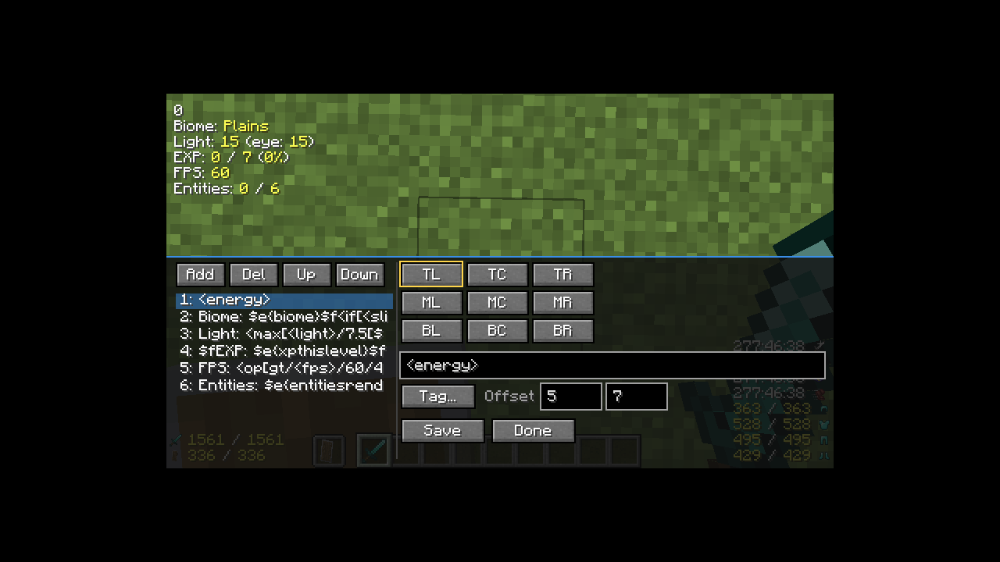

# InGameInfoXML (reloaded)

[InGameInfoXML](https://github.com/Lunatrius/InGame-Info-XML) を現行の Minecraft / Forge /
NeoForge へ移植するリポジトリです。1.12.2 版の HUD 書式・設定・コマンドを基準に、
「同じ設定ファイルで同じ表示になる」ことを目標にしています。

## 現在の状態

| バージョン | ローダー | 状態 |
|---|---|---|
| 1.20.1 | Forge 47.4.28 / Java 17 | 実装・ビルド・HUD / GUI / エディタ描画テスト済み |
| 1.21.1 | NeoForge 21.1.264 / Java 21 | 実装・ビルド・HUD / GUI / エディタ描画テスト済み |
| 26.1.2 | NeoForge 26.1.2.122 / Java 25 | 実装・ビルド・HUD / GUI / エディタ描画テスト済み |

1.20.1 / 1.21.1 / 26.1.2 版は次を移植済みです。

- HUD 描画（テキスト、アイコン、アイテム、ポーション効果、9 アライメント、スケール）
- 既定の `ingameinfo.xml`、XML / JSON / TXT パーサー
- XML / JSON / TXT プリンター（`/igi save`）
- 設定画面（Forge / NeoForge の Config Screen）と `/igi config`
- タグ一覧 GUI（`/igi taglist`）
- HUD エディタ（`F9` または `/igi editor`）。行の追加・削除・並べ替え、
  9 アライメントの選択とオフセット調整、タグ一覧からクリックで挿入、ライブプレビュー
- 主要 MOD の任意連携（Create / Curios / Serene Seasons / Ars Nouveau /
  Iron's Spells 'n Spellbooks / Tough As Nails / Vampirism / Cold Sweat /
  Thirst Was Taken / Goety / Paragliders / Botania / Applied Energistics 2 /
  Mekanism / Cobblemon / Tinkers' Construct / Forge Energy）。MOD が入っていない
  環境ではタグを登録せず、HUD にも影響しません
- `/igi reload`、`load`、`save`、`enable`、`disable`
- 9 言語（en_us, ja_jp, de_de, fr_fr, no_no, pl_pl, ru_ru, zh_cn, zh_tw）
- 1.12.2 の全タグ名（値が再現できないものは互換値。詳細は
  [docs/COMPATIBILITY.md](docs/COMPATIBILITY.md)）
- 他 MOD 連携用の ServiceLoader SPI（[docs/ARCHITECTURE.md](docs/ARCHITECTURE.md)）

## リポジトリ構成

```
.
├── flake.nix                  # JDK / Mesa / Xvfb / ImageMagick 入り dev shell
├── common/                    # バージョン非依存の設計メモ（将来の共有ソース置き場）
├── docs/
│   ├── COMPATIBILITY.md       # 1.12.2 との差異と再現方法
│   ├── ARCHITECTURE.md        # マルチバージョン構成と MOD 連携 SPI
│   ├── RENDER_TEST.md         # ヘッドレス描画テストの手順
│   └── DEBUG_MODS.md          # デバッグ用 MOD の On/Off 手順
├── gradle/debug-mods.gradle   # libs/debug-mods の選択・deobf・run/mods への同期
├── scripts/render-test.sh     # Xvfb + llvmpipe で HUD をスクリーンショット
└── versions/
    ├── 1.20.1/                # Forge 1.20.1 の実装
    ├── 1.21.1/                # NeoForge 1.21.1 の実装
    └── 26.1.2/                # NeoForge 26.1.2 の実装
```

`InGame-Info-XML/` は比較用の 1.12.2 原本で、別 Git リポジトリです（このリポジトリでは
管理しません）。

## 必要環境

Nix 2.18 以降（flake 有効）を推奨します。JDK・Gradle 用 Java・GUI 実行用の
ネイティブライブラリ・Xvfb・Mesa は flake が用意します。

```bash
nix develop .#mc1201     # 1.20.1: Forge / JDK 17
nix develop .#mc1211     # 1.21.1: NeoForge / JDK 21
nix develop .#mc2612     # 26.1.2: NeoForge / JDK 25
```

Nix を使わない場合は、1.20.1 は JDK 17、1.21.1 は JDK 21、26.1.2 は JDK 25 を用意して
ください。Gradle は同梱の wrapper（1.20.1 / 1.21.1 は 8.8、26.1.2 は 9.8.2）を使います。

## ビルド

```bash
# 1.20.1 (Forge)
nix develop .#mc1201 -c bash -c 'cd versions/1.20.1 && ./gradlew build'

# 1.21.1 (NeoForge)
nix develop .#mc1211 -c bash -c 'cd versions/1.21.1 && ./gradlew build'

# 26.1.2 (NeoForge)
nix develop .#mc2612 -c bash -c 'cd versions/26.1.2 && ./gradlew build'
```

成果物は `versions/<version>/build/libs/ingameinfoxml-*.jar` です。1.20.1 は Forge
47.4.28、1.21.1 は NeoForge 21.1.264、26.1.2 は NeoForge 26.1.2.122 のクライアント・
サーバーにそのまま入れられます。

## クライアント起動

```bash
nix develop .#mc1201 -c bash -c 'cd versions/1.20.1 && ./gradlew runClient'
nix develop .#mc1211 -c bash -c 'cd versions/1.21.1 && ./gradlew runClient'
nix develop .#mc2612 -c bash -c 'cd versions/26.1.2 && ./gradlew runClient'
```

1.21.1 以降（ModDevGradle）で特定のワールドを直接開く場合は
`-PquickPlayWorld=RenderTest` を付けます。1.20.1（ForgeGradle）は
`--args="--quickPlaySingleplayer RenderTest"` を使います。

### デバッグ用 MOD の On/Off

任意の MOD を一時的に入れて開発クライアントを起動できます。jar はリポジトリに
含めず、`versions/<version>/libs/debug-mods/` に置きます。有効化はバージョンごとの
`build.gradle` にある `ext.debugMods` の true/false で切り替えます。

```groovy
// versions/1.20.1/build.gradle
ext.debugMods = [
        tconstruct: true,   // Mantle は自動で追加
        cobblemon: false,
        mekanism: false,
        ae2: false,
]
```

```bash
cd versions/1.20.1
./gradlew listDebugMods   # jar と ON/OFF の一覧
./gradlew runClient       # true の MOD を同期して起動
./gradlew syncDebugMods   # 同期だけ実行（すべて false で解除）
```

依存 MOD（例: Cobblemon → Kotlin for Forge、AE2 → GuideME）は、jar があれば
自動で一緒に読み込まれます。詳細は [docs/DEBUG_MODS.md](docs/DEBUG_MODS.md)。

## ヘッドレス描画テスト

Xvfb（仮想 X サーバー）と Mesa の llvmpipe（ソフトウェア GL）でクライアントを起動し、
HUD を PNG に保存します。GPU もログインも不要です。

```bash
GRADLE_USER_HOME=/tmp/gradle-home \
  nix develop .#mc1201 -c scripts/render-test.sh 1.20.1 RenderTest
GRADLE_USER_HOME=/tmp/gradle-home \
  nix develop .#mc1211 -c scripts/render-test.sh 1.21.1 RenderTest
GRADLE_USER_HOME=/tmp/gradle-home \
  nix develop .#mc2612 -c scripts/render-test.sh 26.1.2 RenderTest
```

出力は `docs/render/hud-<version>.png` と `docs/render/client-<version>.log`。テスト用
ワールドの作り方は [docs/RENDER_TEST.md](docs/RENDER_TEST.md) を参照してください。
`HUD_DELAY=60` のように待ち時間を延ばせます。

## 設定

初回起動時にローダーの設定ファイル `config/ingameinfoxml-client.toml`（1.20.1 は
Forge、1.21.1 / 26.1.2 は NeoForge）と、表示定義
`config/InGameInfo.xml` が生成されます（表示定義は 1.12.2 と同じファイル名・書式）。

- `/igi reload` — 表示定義を再読み込み
- `/igi load <file>` — 別の表示定義を読み込み
- `/igi save <file.xml|file.json|file.txt>` — 現在の表示定義を保存
- `/igi enable` / `/igi disable` — HUD の一時的な有効・無効
- `/igi taglist` — 登録タグの一覧 GUI
- `/igi editor` — HUD エディタを開く（既定キーは `F9`）
- `/igi alignment get|set <ALIGN> [x y]` — アライメントのオフセット
- `/igi config <key> <value>` — 設定の変更

## 1.12.2 との違い（要約）

レガシーな数値 ID・ブロック metadata・クライアント側のワールドファイルサイズなど、
1.20.1 以降に存在しない概念があります。タグ名と出力形式は維持し、再現できない値は
「-1」「0」「?」などの互換値にしています。また、明確な描画バグ（HUD の二重描画、
ポーションアイコンの Y 二重加算）は修正しています。全リストは
[docs/COMPATIBILITY.md](docs/COMPATIBILITY.md) を参照してください。

## HUD エディタ

`F9` または `/igi editor` で、画面下にエディタが開きます。HUD は上に残るので、
編集結果をその場で確認できます。

- 左側: 選択中アライメントの行一覧。`Add` / `Del` / `Up` / `Down` で編集
- 右側: 9 アライメントの選択、行テキスト、タグ一覧（`Tag...`）、X / Y オフセット
- `Save`: `config/InGameInfo.xml` とアライメント設定を保存
- `Done`: 保存して閉じる。`Esc` は保存せずに閉じる（編集内容は破棄）

行テキストは TXT パーサーと同じ書式です。`<username>` のようなタグを直接入力するか、
`Tag...` から選ぶとカーソル位置に挿入されます。不正な行がある場合は保存を中止し、
ステータスにエラーを表示します。



## MOD 連携

他 MOD はコンパイル時依存なしでタグ・値を作れます。詳しくは
[docs/ARCHITECTURE.md](docs/ARCHITECTURE.md) を参照してください。

1.20.1 / 1.21.1 / 26.1.2 では次の MOD を任意で検出し、入っている場合だけタグを登録します。

| MOD | 主なタグ |
|---|---|
| Create | `createrpmover`, `createkineticover`, `createstressover`, `createstresscapacityover`, `createstresspercentover`, `createnetworksizeover` |
| Curios | `curioslots`, `curioslotcount`, `curioitems`, `curios` |
| Serene Seasons | `season`, `subseason`, `tropicalseason`, `seasonday`, `seasonticks`, `seasonprogress`, `seasonpercent` |
| Ars Nouveau | `arsmana`, `arsmaxmana`, `arsmanapercent` |
| Iron's Spells 'n Spellbooks | `ironsmana`, `ironsmaxmana`, `ironsmanapercent` |
| Tough As Nails | `thirst`, `hydration`, `temperature`, `bodytemperature` |
| Vampirism | `blood`, `maxblood`, `bloodpercent`, `vampirelevel` |
| Cold Sweat | `coldsweat`, `coldsweatworld` |
| Thirst Was Taken | `twtthirst`, `twtquenched`, `twtexhaustion` |
| Goety | `goetysouls`, `goetyactive` |
| Paragliders | `stamina`, `maxstamina`, `staminapencent`, `staminadepleted` |
| Botania（1.20.1 のみ） | `botaniamana`, `botaniamaxmana`, `botaniamanapercent` |
| Applied Energistics 2 | `ae2networkover`, `ae2channelsover`, `ae2channelmodeover`, `ae2gridpowerover`, `ae2gridpowerusageover`, `ae2cellused`, `ae2celltotal`, `ae2celltypes`, `ae2cellstatus` ほか |
| Mekanism | `mekanismradiation`, `mekanismradiationlevel`, `mekanismradiationmax`, `mekanismradiationseverity`, `mekanismradiationenabled`, `mekanismradiationpercent` |
| Cobblemon | `cobblemonpartysize`, `cobblemonparty1`〜`cobblemonparty6`（種族・レベル・HP・状態・色違い・タイプ） |
| Tinkers' Construct（1.20.1 のみ） | `tinkersdurability`, `tinkersmaxdurability`, `tinkersdurabilitypercent`, `tinkersminingspeed`, `tinkersattackdamage`, `tinkersharvestlevel`, `tinkersmodifiers`, `tinkersbroken` |
| Forge / NeoForge Energy（常時） | `energy`, `maxenergy`, `energypercent`, `fe` ほか |

クロスヘア先のブロックを優先して読むタグは末尾に `over` を付けます
（`createrpmover`, `ae2networkover` など）。Create は搭乗中の装置、AE2 は
リンク済みワイヤレス端末にもフォールバックしますが、名前は `over` に統一しています。
旧名（`createrpm`, `ae2network` など）は別名として残しているため、既存の設定ファイルは
そのまま動きます。Create のタグは対象ブロックがない場合も行を消さず、RPM・ストレス系は
`0.0`、`createkineticover` は `false` を返します（搭乗中の Create 装置がある場合は
そちらを読みます）。

Paragliders は 1.20.1 / 1.21.1 の実クライアントで HUD 表示まで確認済みです。
Applied Energistics 2 はクロスヘア先のブロックのネットワークを優先し、見ていない
場合はリンク済みワイヤレス端末、どちらもなければ `none` を表示します。1.21.1 の
実クライアントでチャンネル数・チャンネルモード・グリッド電力・使用量・セル容量／
状態まで確認済み、1.20.1 は本番起動でネットワーク系タグを確認済みです（セル値は
ログで確認、HUD 行の定常表示は自動操作の制約で未撮影）。
Mekanism と Cobblemon は 1.21.1 の実クライアントで、放射線量（個人・環境・最大・
深刻度・有効・割合）とパーティ（種族・レベル・HP・状態・色違い・タイプ）の HUD 表示を
確認済みです。Tinkers' Construct は 1.20.1 の ForgeGradle 開発クライアントで 8 タグの表示を
確認しました（`libs/debug-mods` の jar を `build.gradle` の `ext.debugMods` で
`tconstruct: true` にして deobf 読み込み。`/give` の素材未設定ツールのため数値は最小値）。
1.20.1 の Mekanism / Cobblemon と 26.1.2 の 3 連携はビルド確認までです。
MOD が入っていない場合や API が変わった場合はタグを登録しない／空文字を返すため、
HUD の他の行には影響しません。
連携はリフレクションで実装しているため、MOD 側の API が変わると値が空になる
ことがあります。

## ライセンス

MIT。元実装 Copyright 2014-2016 Jadran "Lunatrius" Kotnik、1.20.1 / 1.21.1 / 26.1.2 移植の土台は
Copyright 2025 DF11ZomGraves。`LICENSE` を参照してください。
