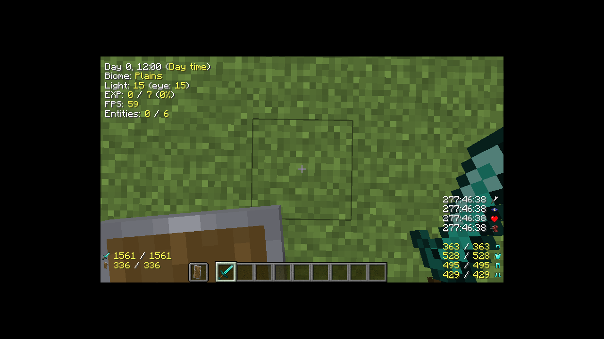
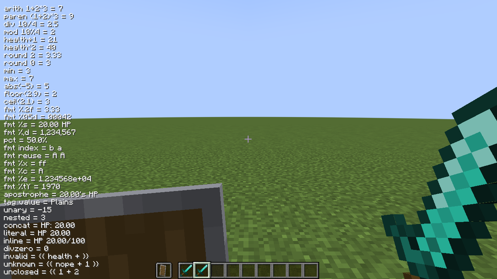

# InGameInfoXML (reloaded)

[English](README.md) | [日本語](README_ja.md)

[InGameInfoXML](https://github.com/Lunatrius/InGame-Info-XML) の Forge / NeoForge 移植です。
1.12.2 の HUD 定義（XML / JSON / TXT）をできるだけそのまま使い、Minecraft 1.20.1 /
1.21.1 / 26.1.2 で表示できます。



## 特徴

- 1.12.2 の XML / JSON / TXT 定義、タグ名、9 アライメント、スケールを移植
- テキスト、アイコン、アイテム、ポーション効果、防具の耐久値を HUD に表示
- 設定画面、タグ一覧、HUD エディタ、デバッグ要素インスペクター
- 計算式 `{{ ... }}` による四則演算・関数・書式指定。従来の `{tag}` もそのまま使える
- Create、Curios、AE2、Mekanism、Cobblemon などの任意 MOD 連携
- 9 言語（en_us、ja_jp、de_de、fr_fr、no_no、pl_pl、ru_ru、zh_cn、zh_tw）

## 対応バージョン

| Minecraft | ローダー | Java | 状態 |
|---|---|---|---|
| 1.20.1 | Forge 47.4.28 | 17 | ビルド・HUD / GUI 描画確認済み |
| 1.21.1 | NeoForge 21.1.264 | 21 | ビルド・HUD / GUI 描画確認済み |
| 26.1.2 | NeoForge 26.1.2.122 | 25 | ビルド・HUD / GUI 描画確認済み |

## ビルドと導入

Nix（flake 有効）を使うと、JDK・Gradle 用 Java・GUI 実行用のライブラリがそろいます。

```bash
nix develop .#mc1201 -c bash -c 'cd versions/1.20.1 && ./gradlew build'
nix develop .#mc1211 -c bash -c 'cd versions/1.21.1 && ./gradlew build'
nix develop .#mc2612 -c bash -c 'cd versions/26.1.2 && ./gradlew build'
```

成果物は `versions/<version>/build/libs/ingameinfoxml-2.9.2.101.jar` です。対応する
Minecraft の `mods/` ディレクトリへ入れます。Nix を使わない場合は、各バージョンに
合った JDK と同梱の Gradle wrapper を用意してください。

## 使い方

初回起動時に、ローダーの設定ファイル `config/ingameinfoxml-client.toml` と、表示定義
`config/InGameInfo.xml` が生成されます。表示定義は 1.12.2 と同じファイル名と書式です。

### コマンド

| コマンド | 内容 |
|---|---|
| `/igi reload` | 表示定義を再読み込み |
| `/igi load <file>` | 別の表示定義を読み込み |
| `/igi save <file>` | 現在の表示定義を保存（拡張子で XML / JSON / TXT を選ぶ） |
| `/igi enable` / `/igi disable` | HUD の一時的な有効・無効 |
| `/igi taglist` | 登録タグの一覧 GUI |
| `/igi debug` | デバッグ要素インスペクターを開く（既定キー `F8`） |
| `/igi editor` | HUD エディタを開く（既定キー `F9`） |
| `/igi alignment get <ALIGN>` | アライメントのオフセットを表示 |
| `/igi alignment set <ALIGN> [x y]` | アライメントのオフセットを変更 |
| `/igi config <key> <value>` | 設定の変更 |

### GUI

- 設定画面は Mods 画面の Config から開きます。表示定義のファイル名、スケール、
  バニラ HUD の表示、アライメントなどを変更できます
- HUD エディタ（`F9`）は画面下に開き、行の追加・削除・並べ替え、タグの挿入、
  9 アライメントの選択、X / Y オフセットの調整ができます
- デバッグ要素インスペクター（`F8`）は、登録されている全タグと現在値をカテゴリ別に
  表示します。タグ名をクリックすると `<tag>` をコピーできます

## 表示定義

`config/InGameInfo.xml` の `<lines at="...">` に表示行を書きます。1.12.2 の定義を
そのままコピーしても動作します。

```xml
<config>
  <lines at="topleft">
    <line><str>HP: {health}/{maxhealth}</str></line>
    <line><str>座標: {{ round(x, 1) }}, {{ round(z, 1) }}</str></line>
  </lines>
</config>
```

`{tag}` はタグの値に置き換わります。色コードは `$0`〜`$f` と `$r` を使えます。
JSON / TXT 形式の読み込みと、`/igi save` による拡張子別の書き出しが可能です。

## 計算式 `{{ ... }}`

`{{ ... }}` の中では、タグ名を値として四則演算・括弧・関数に渡せます。

```xml
<str>ダメージ: {{ attackdamage * 2 + 1 }}</str>
<str>HP 割合: {{ format("%.1f", health / maxhealth * 100) }}%</str>
```

- 演算子: `+` `-` `*` `/` `%`、括弧、単項の `+` / `-`
- 関数: `round`、`min`、`max`、`abs`、`floor`、`ceil`、`format`
- `format("書式", 値)` は Java の `String.format(Locale.ENGLISH, ...)` と同じ順序

未知のタグや文法エラーがあると、その `{{ ... }}` は元の文字列のまま表示されます。
XML の本文で `<` を書くときは `&lt;` にしてください。詳細は
[docs/EXPRESSIONS.md](docs/EXPRESSIONS.md)。



## MOD 連携

対応 MOD が入っているときだけ、その MOD のタグを登録します。MOD がない環境では
タグを登録しないため、HUD の他の行には影響しません。コンパイル時の依存もありません。

| 分類 | MOD | 対応バージョン |
|---|---|---|
| 装備・状態 | Curios、Tough As Nails、Cold Sweat、Thirst Was Taken、Vampirism、Paragliders | すべて |
| テクノロジー | Create、Applied Energistics 2、Mekanism | すべて |
| エネルギー | Forge / NeoForge Energy | すべて |
| 魔法 | Botania | 1.20.1 |
| 魔法 | Ars Nouveau、Iron's Spells 'n Spellbooks、Goety | すべて |
| 世界・その他 | Serene Seasons、Cobblemon | すべて |
| 世界・その他 | Tinkers' Construct | 1.20.1 |

「すべて」は 1.20.1 / 1.21.1 / 26.1.2 のすべてでタグを登録する意味です。実際に値まで
確認した範囲は [docs/COMPATIBILITY.md](docs/COMPATIBILITY.md) にまとめています。

クロスヘア先のブロックを第一候補にするタグは、末尾に `over` を付けます
（`createrpmover`、`ae2networkover` など）。タグ名、旧名の別名、値の確認状況は
[docs/COMPATIBILITY.md](docs/COMPATIBILITY.md) にまとめています。

## ドキュメント

| 文書 | 内容 |
|---|---|
| [docs/README.md](docs/README.md) | 目的別の読む順番と文書一覧 |
| [docs/COMPATIBILITY.md](docs/COMPATIBILITY.md) | 1.12.2 との違い、設定キー、タグ、互換値 |
| [docs/EXPRESSIONS.md](docs/EXPRESSIONS.md) | 計算式の文法、関数、書式、失敗時の挙動 |
| [docs/DEBUG_SCREEN.md](docs/DEBUG_SCREEN.md) | デバッグ要素インスペクターの操作 |
| [docs/DEBUG_MODS.md](docs/DEBUG_MODS.md) | 開発用 MOD の On/Off |
| [docs/RENDER_TEST.md](docs/RENDER_TEST.md) | ヘッドレス描画テストの手順と結果 |
| [docs/ARCHITECTURE.md](docs/ARCHITECTURE.md) | 構成、処理の流れ、MOD 連携 SPI |

## 開発

### リポジトリ構成

```
.
├── flake.nix                  # JDK / Mesa / Xvfb / ImageMagick 入り dev shell
├── LICENSE                    # MIT
├── README.md                  # 英語版
├── README_ja.md               # 日本語版
├── common/                    # バージョン非依存の設計メモ
├── docs/                      # 利用者・開発者向けの文書
├── gradle/debug-mods.gradle   # 開発用 MOD の選択と deobf
├── scripts/render-test.sh     # Xvfb + llvmpipe で HUD を撮影
└── versions/
    ├── 1.20.1/                # Forge 1.20.1
    ├── 1.21.1/                # NeoForge 1.21.1
    └── 26.1.2/                # NeoForge 26.1.2
```

バージョンごとに Gradle プロジェクトを分けています。開発クライアントは
`cd versions/<version> && ./gradlew runClient` で起動します。

### 開発用 MOD

`versions/<version>/libs/debug-mods/` に jar を置き、`build.gradle` の
`ext.debugMods` を true にすると、その MOD を入れた状態で起動できます。

```groovy
ext.debugMods = [
        tconstruct: true,   // Mantle は自動で追加
        cobblemon: false,
        mekanism: false,
        ae2: false,
]
```

一覧は `./gradlew listDebugMods`、同期だけなら `./gradlew syncDebugMods` です。
詳しくは [docs/DEBUG_MODS.md](docs/DEBUG_MODS.md) を参照してください。

### 描画テスト

Xvfb と Mesa の llvmpipe で実クライアントを起動し、HUD を PNG に保存できます。

```bash
GRADLE_USER_HOME=/tmp/gradle-home \
  nix develop .#mc1201 -c scripts/render-test.sh 1.20.1 RenderTest
```

テスト用ワールドの作り方、確認項目、バージョン別の結果は
[docs/RENDER_TEST.md](docs/RENDER_TEST.md) にあります。

## ライセンス

MIT。元実装 Copyright 2014-2016 Jadran "Lunatrius" Kotnik、1.20.1 / 1.21.1 / 26.1.2
移植の元は Copyright 2025 DF11ZomGraves。全文は [LICENSE](LICENSE) にあります。
