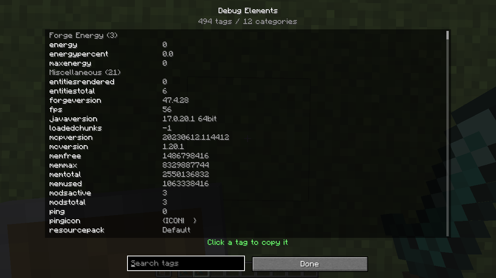
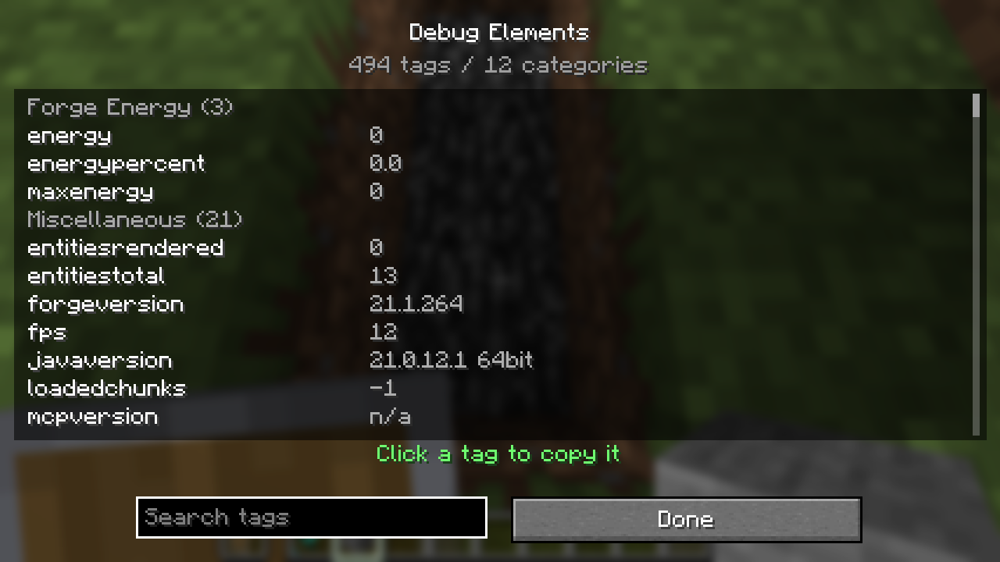
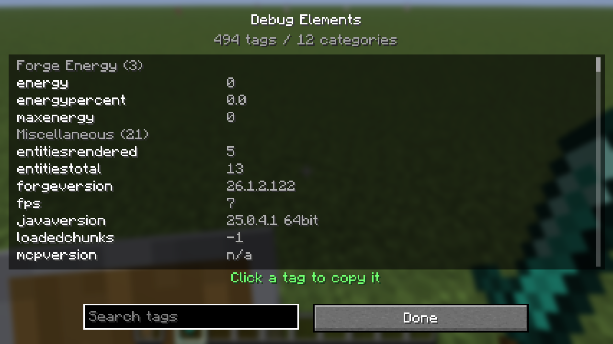

# デバッグ要素インスペクター

HUD に出せるタグを一画面で確認するための、読み取り専用のデバッグ画面です。
HUD の XML を書く前に「このタグは今どんな値を返すのか」「MOD 連携タグが本当に
登録されているか」を確かめる用途を想定しています。

## 開き方

- `F8`（ゲーム画面が何も開いていないとき）
- `/igi debug`

どちらも `GuiDebugElements` を開きます。HUD エディタ（`F9`）や設定画面とは独立した
画面で、編集中の HUD には触れません。デバッグ画面を開いている間は HUD を描画しません
（背後に隠れて読めなくなるため）。

## 表示されるもの

- 登録されている全タグを、ローカライズされたカテゴリごとに一覧表示
- タグ名の右に、その時点の値
- 一覧の上に「タグ数 / カテゴリ数」
- カテゴリ内はタグ名のアルファベット順。`formatting`（色コード）だけは末尾
- インデックス付きのタグ（`nearbyplayer*` など）は `nearbyplayerabsorption0` の
  ように実際のインデックス付きで表示

開いた直後は検索欄にフォーカスがあります。そのまま文字を打つと絞り込めます。
値は 20 tick（約 1 秒）ごとに取り直します。ワールドに入った直後や、チェストを開いた
直後など、値が変わる操作のあとに少し待つと反映されます。値の取得中に例外が出た
タグは、値の欄に赤で `ERROR: ...` と表示されます。画面全体は止まりません
（`isPauseScreen()` は false）。

Mekanism / Cobblemon / Tinkers' Construct などの任意連携は、MOD が入っているときだけ
タグが登録されます。デバッグ画面を開けば、連携タグが増えていることと現在値を
その場で確認できます。MOD が入っていない環境では、そのカテゴリ自体が出ません。

## 操作

| 操作 | 動作 |
| --- | --- |
| 検索欄 | タグ名と説明文（ローカライズ済み）の部分一致で絞り込み |
| ホイール | 3 行ずつスクロール |
| タグ名をクリック | `<タグ名>` をクリップボードへコピー |
| `Done` / `Esc` | 閉じる |

クリックでコピーされるのは、XML / TXT にそのまま貼れる `<...>` 形式です。
インデックス付きタグは `<nearbyplayerhealth0>` のように、表示中のインデックス付きの
名前をコピーします。コピーすると一覧の下に「`<...>` をコピーしました」と出ます。

## スクリーンショット

1.20.1（Forge、GUI scale 2）:

1.21.1（NeoForge、GUI scale 3）:

26.1.2（NeoForge、GUI scale 3）:

いずれも `/igi debug` または `F8` で開き、Xvfb + llvmpipe のヘッドレス環境で
1280x720 のスクリーンショットを撮ったものです。テスト環境（追加 MOD なし）では
`494 tags / 12 categories` でした。Mekanism と Cobblemon を入れた 1.21.1 では
`632 tags` になり、連携タグが増えることを確認しています。

## 実装メモ

- `client/gui/debug/GuiDebugElements` が画面本体
- `TagRegistry#getUniqueTags()` が登録タグを重複なしで返す
- `Tag#getValueForDebug(Tag)` が `Tag.info` を一時退避して 1 タグだけ評価する。
  例外は握りつぶさず `ERROR: ...` として画面に出す
- 26.1.2 は描画 API が違うため `GuiGraphicsExtractor` / `extractRenderState` を使う。
  ロジックは 1.20.1 / 1.21.1 と同じ

関連: [RENDER_TEST.md](RENDER_TEST.md) の「デバッグ要素インスペクター」、
[ARCHITECTURE.md](ARCHITECTURE.md) の「デバッグ要素インスペクター」。
