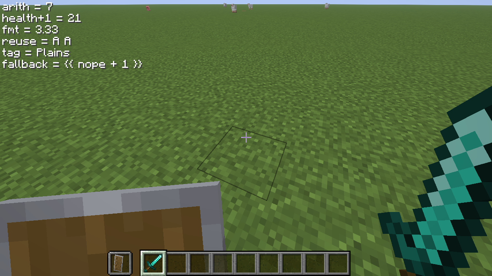

# 計算式 `{{ ... }}`

HUD のテキスト中で `{{ ... }}` と書くと、その中を計算式として評価します。1.12.2 から
ある `{tag}` はそのまま使え、式の中でもタグ名を直接書けます。

## 基本

```xml
<str>HP: {{ health }} / {{ maxhealth }}</str>
<str>ダメージ: {{ attackdamage * 2 + 1 }}</str>
<str>座標: {{ round(x, 1) }} / {{ round(z, 1) }}</str>
<str>HP 割合: {{ format("%.1f", health / maxhealth * 100) }}%</str>
```

`{{ }}` の外側は従来どおり `{tag}` を置換します。式の中のタグ名は、登録済みの
タグ名（別名を含む）をそのまま書きます。`{ }` は付けず、`{{ health + 1 }}` のように
書きます。タグの値は評価のたびに読み直すため、パース結果だけをキャッシュしても HP や
座標は更新されます。XML / JSON / TXT のどの定義でも、HUD エディタの行テキストでも
同じように使えます。

## 値

| 種類 | 例 | 備考 |
|---|---|---|
| 数値 | `1`, `2.5`, `.5`, `1e3` | 内部では `double` |
| 文字列 | `"HP"`, `'HP'` | `\n`, `\t`, `\"`, `\u3042` などのエスケープ可 |
| タグ | `health`, `biome`, `x` | 登録済みのタグ名。値は文字列として取り込む |

数値が必要な場所では、タグの文字列を数値に変換します。変換できない場合は式全体が
失敗します（後述）。

## 演算子

| 優先順位 | 演算子 | 意味 |
|---|---|---|
| 1（高い） | `+` `-`（単項） | 符号 |
| 2 | `*` `/` `%` | 乗算・除算・剰余 |
| 3（低い） | `+` `-` | 加算・減算 |

- 括弧 `( )` で優先順位を変えられます。
- 同じ優先順位は左から評価します（`10 - 3 - 2` は `5`）。
- `+` は、両方が数値なら加算、そうでなければ文字列連結です。
  - `{{ 1 + 2 }}` → `3`
  - `{{ "HP: " + health }}` → `HP: 20.00`
- `/` と `%` の右辺が `0` のときは `0` を返します（例外にしません）。
- 比較（`>`, `==` など）、論理演算、ビット演算、三項演算子はありません。

## 関数

### `round(x[, digits])`

- `round(x)` / `round(x, 0)`: 最も近い整数（`.5` は正の無限大方向へ丸め）。
- `round(x, 2)`: 小数点以下 2 桁。正の `digits` を指定したときは
  `String.format("%.2f", x)` と同じ固定桁の文字列になります（`3` は `3.00`）。
- `round(x, -1)`: 10 の位で丸めます（`123` は `120`）。
- `digits` は整数に変換されます（`2.9` は `2`）。

### `min(...)` / `max(...)`

1 個以上の引数から最小・最大を返します。

```xml
<str>{{ min(health, maxhealth) }}</str>
<str>{{ max(1, round(2.6)) }}</str>
```

### `abs(x)` / `floor(x)` / `ceil(x)`

絶対値・切り捨て・切り上げです。引数は 1 個だけです。

### `format("書式", 値, ...)`

Java の `String.format(Locale.ENGLISH, ...)` をそのまま使います。第 1 引数が書式、
以降が値です（Java と同じ順序）。

```xml
<str>{{ format("%.2f", 10 / 3) }}</str>          <!-- 3.33 -->
<str>{{ format("%05d", 42) }}</str>             <!-- 00042 -->
<str>{{ format("%,d", 1234567) }}</str>         <!-- 1,234,567 -->
<str>{{ format("%.1f%%", 50) }}</str>           <!-- 50.0% -->
<str>{{ format("%2$s %1$s", "A", "B") }}</str>  <!-- B A -->
<str>{{ format("%s %&lt;s", "A") }}</str>       <!-- A A -->
<str>{{ format("%tY", 0) }}</str>               <!-- 1970 -->
```

対応する主な変換子は `%d`, `%o`, `%x`, `%X`, `%f`, `%e`, `%g`, `%a`,
`%c`, `%s`, `%b`, `%h`, `%t...`/`%T...` です。フラグ（`-`, `+`、`0`、
`,`、`#`、`(`）、幅、精度、`n$` による引数番号、`%<`（直前の引数の再利用）、
`%%`、`%n` も Java と同じです。

- `%d` / `%x` など整数系は、小数を 0 方向へ切り捨てて `long` にします。
- `%f` など浮動小数系は `double` にします。
- `%c` は、数値ならそのコードポイント、文字列なら先頭 1 文字にします。
- `%t` / `%T` は `long` をエポックミリ秒として扱います。
- `%s` は Java の `toString` を使います。数値リテラル `20` は `20.0` に
  なります。小数の桁を揃えたいときは `%.2f` を使ってください。
- 書式と引数の数・型が合わない場合は、式全体が失敗します。

## 数値の既定書式

`format` を使わずに数値を返したときは、次のように表示します。

- 整数なら小数点以下を出しません（`10 / 5` → `2`）。
- それ以外は最大 3 桁に丸め（HALF_UP）、末尾の 0 を落とします
  （`10 / 3` → `3.333`、`10 / 4` → `2.5`）。
- 非有限値（`NaN`, `Infinity`）と 0 除算は `0` になります。

## 失敗したとき

次の場合は、その `{{ ... }}` を **元の文字列のまま** HUD に残します。式の一部だけが
置換されることはありません。

- 未知のタグ（`{{ nope + 1 }}`）
- 文法エラー（`{{ health + }}`、閉じていない `{{`）
- 未知の関数（`{{ foo(1) }}`）
- 数値に変換できないタグ（`{{ biome * 2 }}`）
- `format` の書式エラー（引数不足、不正な変換子など）

```
HP: {{ health + }}        # そのまま表示される
```

式の外側にある `{tag}` は従来どおり置換されます。

## XML で書くときの注意

XML のテキストに `<` や `&` をそのまま書くとパースエラーになります。式の中で
`<` を使うときは `&lt;`、`&` は `&amp;` にしてください。

```xml
<!-- OK: 表示は %<s -->
<str>{{ format("%s %&lt;s", "A") }}</str>

<!-- NG: XML のパースに失敗する -->
<str>{{ format("%s %<s", "A") }}</str>
```

## 制限

- 代入・変数定義・条件分岐はありません。条件によって表示を変える場合は、1.12.2 から
  ある `<if>` / `<str>` の仕組みを使ってください。
- 文字列関数（部分文字列・大文字小文字変換など）はありません。
- 式の入れ子（`{{ {{ 1 }} }}`）はできません。
- 数値は `double` です。整数の桁落ちを避けたい用途には向きません。
- `format` のロケールは `Locale.ENGLISH` 固定です（`,` は桁区切り）。
- 1.12.2 の定義に `{{ ... }}` という文字列が含まれていると、本移植では式として
  評価されます。1.12.2 にはこの構文がないため、そのような定義は互換性の対象外です。

## 確認結果

1.20.1 / 1.21.1 / 26.1.2 のすべてで、Xvfb + llvmpipe の 1280x720 に描画して確認
しています。1.20.1 では四則演算・括弧・単項演算・全関数・`format` の各変換子・
失敗時のリテラル保持を含む 35 行を確認しました。


1.21.1 と 26.1.2 では、代表的な 6 行（四則演算、タグとの加算、`format`、`%<`、
タグ値、失敗時のリテラル保持）を確認しています。




主な確認値は次のとおりです。

| 式 | 結果 |
|---|---|
| `{{ 1 + 2 * 3 }}` | `7` |
| `{{ (1 + 2) * 3 }}` | `9` |
| `{{ 10 / 4 }}` | `2.5` |
| `{{ health + 1 }}` | `21`（HP 20.00 のとき） |
| `{{ round(10 / 3, 2) }}` | `3.33` |
| `{{ min(3, 7) }}` / `{{ max(3, 7) }}` | `3` / `7` |
| `{{ format("%05d", 42) }}` | `00042` |
| `{{ format("%.1f%%", 50) }}` | `50.0%` |
| `{{ format("%s %&lt;s", "A") }}` | `A A` |
| `{{ nope + 1 }}` | `{{ nope + 1 }}`（リテラル） |
