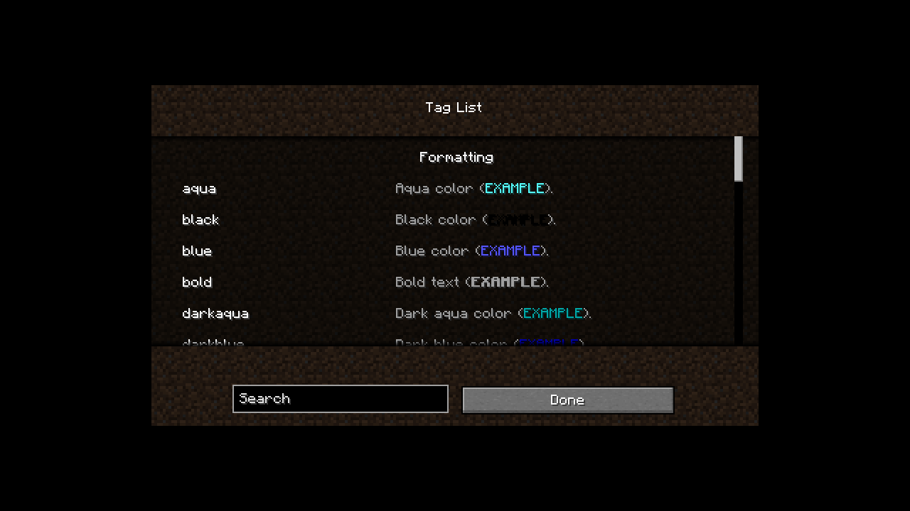
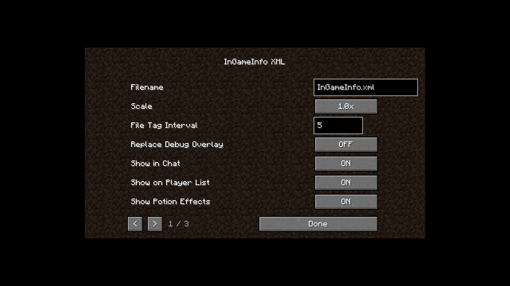
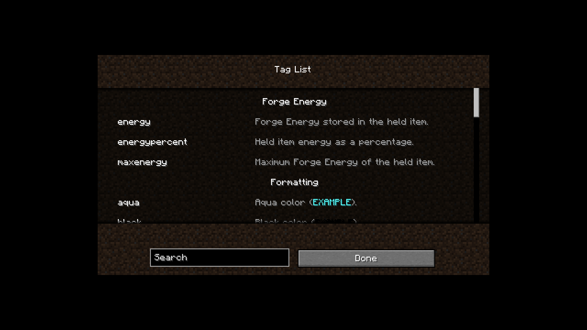
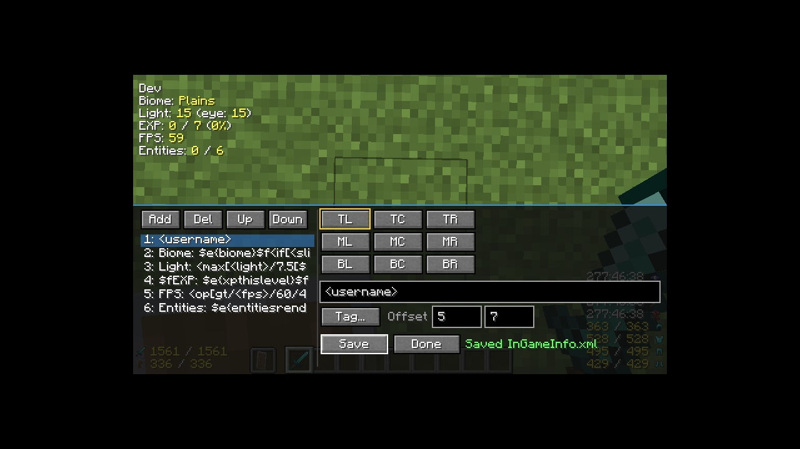

# 描画テスト

この文書は、GUI のない環境（SSH・CI・NixOS のヘッドレス機）で InGameInfoXML の HUD と
GUI を実際に描画し、スクリーンショットで確認する手順をまとめたものです。1.20.1 で
確立した手順を、将来の 1.21.1 / 26.1.2 でも同じ形で使えるようにしています。

## 対象

- HUD のテキスト（色コード・XML タグ・条件分岐を含む）
- メインハンド / オフハンドのアイテムと耐久値
- ポーション効果の名前・倍率・残り時間・アイコン
- 防具の耐久値とアイコン
- `<icon>`（画像）、`<item>`（アイテム）、`pingicon`
- タグ一覧 GUI（`/igi taglist`）
- 設定 GUI（Forge Config Screen）の全ページ
- HUD エディタ（`F9` / `/igi editor`）。行編集、タグ挿入、保存、オフセットの再起動後の保持
- コマンド（`/igi save`、`/igi reload` など）の入出力

MOD 連携タグそのものは、連携 MOD を入れた環境で別途確認します。SPI の読み込みだけなら
ログの `PluginLoader` 出力で確認できます。

## 前提

- Nix（flake 有効）と、このリポジトリの `flake.nix`
- Xvfb・xdotool・ImageMagick・Mesa（llvmpipe）— すべて `mc1201` シェルに入っています
- 1.20.1 のテスト用ワールド（下記で作成）
- 実クライアントを起動できる程度のメモリ（2 GB 以上を推奨）

```bash
cd /path/to/InGameInfo-reloaded
nix develop .#mc1201
```

以降のコマンドはリポジトリのルートで実行します。Nix を使わない場合は JDK 17、
Gradle wrapper、Xvfb、xdotool、ImageMagick、Mesa を自分で用意してください。

## テスト用ワールド

描画テストは「ワールドが既にある」ことを前提にしています。ワールドは
`versions/1.20.1/run/saves/RenderTest` に置きます（`run/` は Git 管理外です）。

### 1. ワールドを作る

```bash
cd versions/1.20.1
GRADLE_USER_HOME=/tmp/gradle-home ./gradlew runClient
```

ゲーム内で **Singleplayer → Create New World** を選び、次の設定で作成します。

| 項目 | 値 |
|---|---|
| World Name | `RenderTest` |
| Game Mode | Creative |
| World Type | Default（Flat でも可） |
| Seed | `0`（任意。固定するとスクリーンショットが安定） |
| Allow Cheats | ON |

作成後、ワールドに入って一度終了します。以降は quick play で直接このワールドを開きます。

### 2. テスト用データパックを入れる

`run/saves/RenderTest/datapacks/igi-test/` に次の 3 ファイルを置きます。1.20.1 の
データパック形式（pack_format 15、`data/<namespace>/functions`）です。

`pack.mcmeta`

```json
{"pack":{"pack_format":15,"description":"InGameInfo render test"}}
```

`data/minecraft/tags/functions/tick.json`

```json
{"values":["igi:test"]}
```

`data/igi/functions/test.mcfunction`

```mcfunction
time set noon
weather clear
gamemode creative @a
effect give @a minecraft:speed 999999 2 true
effect give @a minecraft:night_vision 999999 0 true
effect give @a minecraft:strength 999999 1 true
effect give @a minecraft:regeneration 999999 0 true
item replace entity @a armor.head with minecraft:diamond_helmet
item replace entity @a armor.chest with minecraft:diamond_chestplate
item replace entity @a armor.legs with minecraft:diamond_leggings
item replace entity @a armor.feet with minecraft:diamond_boots
item replace entity @a weapon.mainhand with minecraft:diamond_sword
item replace entity @a weapon.offhand with minecraft:shield
```

この関数は tick ごとに実行され、時刻・天候・装備・効果を固定します。HUD の
「Day / Biome / Light / EXP / FPS / Entities / 手持ち / ポーション / 防具」を毎回同じ
状態で比較できるようにするためです。

ワールドを開いた状態でデータパックを追加した場合は、チャットで次を実行します。

```
/reload
/datapack list
/datapack enable "file/igi-test"
/function igi:test
```

`/datapack list` に `igi-test` が enabled と出れば有効です。ワールド作成前に
`datapacks/` へ置いた場合は、ワールド読み込み時に自動で有効になります。

### 3. 表示定義を確認する

初回起動で `run/config/InGameInfo.xml` が生成されます。HUD の既定表示はこのファイルで
決まります。テスト中にカスタム定義へ差し替えた場合は、退避してから削除するか、
元の内容に戻して `/igi reload` してください（既定ファイルは削除しても次回起動時に
再生成されます）。

設定値は `run/config/ingameinfoxml-client.toml` です。スクリーンショットを既定値で
揃えたい場合は、この TOML も退避してから削除します。

## HUD の自動テスト

`scripts/render-test.sh` が Xvfb を起動し、quick play でワールドに入り、指定秒数後に
ルートウィンドウを PNG に保存します。

```bash
cd /path/to/InGameInfo-reloaded
GRADLE_USER_HOME=/tmp/gradle-home \
  nix develop .#mc1201 --command scripts/render-test.sh 1.20.1 RenderTest
```

- 出力: `docs/render/hud-1.20.1.png`
- ログ: `docs/render/client-1.20.1.log`
- 待ち時間: 既定 20 秒。`HUD_DELAY=60` のように延ばせる
- 画面: 1280x720x24、GLX 有効、llvmpipe（ソフトウェア GL）

スクリプトはクライアントを起動したあと `xdotool search --name "Minecraft"` で
ウィンドウを探し、見つかったら待ってから `import -window root` で撮ります。GPU も
ログインも不要です。

### うまくいかないとき

- **Minecraft ウィンドウが出ない**: ログの末尾を確認します。`glfwInit` や
  `Failed to create display` が出る場合は、Gradle デーモンが Xvfb の DISPLAY を
  引き継いでいないことが原因です。スクリプトは `--no-daemon` を付けています。
  手動で試すときも必ず `--no-daemon` を付けてください。
- **画面が真っ黒**: `LIBGL_ALWAYS_SOFTWARE=1`、`GALLIUM_DRIVER=llvmpipe`、
  `MESA_LOADER_DRIVER_OVERRIDE=llvmpipe` が dev shell で設定されているか確認します。
- **ワールドが見つからない**: `versions/1.20.1/run/saves/RenderTest` があるか、
  名前が一致しているか確認します。quick play は名前の一致に厳密です。
- **前回のプロセスが残っている**: `pgrep -af 'gradle|Minecraft'` を確認し、
  必要なら `pkill -f 'quickPlaySingleplayer RenderTest'` で止めます。
- **設定が残っていて表示が違う**: `run/config/InGameInfo.xml` と
  `run/config/ingameinfoxml-client.toml` を退避して再実行します。

## 目視確認のポイント

`docs/render/hud-1.20.1.png` で次を確認します。

1. 左上のテキストが 6 行程度表示され、`Day`・`Biome`・`Light`・`EXP`・`FPS`・
   `Entities` の値が入っている。
2. 黄色（`$e`）と白（`$f`）の色分けがされている。ピクセル色は目安として
   `#FCFC54`（黄）と `#FCFCFC`（白）。
3. 左下にメインハンド（ダイヤモンドの剣）とオフハンド（盾）のアイコン・耐久値が出る。
4. 右下に 4 つのポーション効果（Speed II / Night Vision / Strength II / Regeneration）が
   名前・倍率・残り時間・アイコン付きで並ぶ。
5. 防具 4 部位の耐久値とアイコンが重ならない。
6. HUD が二重に描画されていない（同じ行が 2 回出ていない）。

### 追加の描画確認（icon / item / pingicon）

`<icon>` のテクスチャ、`<item>` のアイテム、`pingicon` は既定定義には常時出ないため、
一時的な表示定義で確認します。`run/config/InGameInfo.xml` を退避し、`<icon>`、
`<item>`、`<pingicon>` を含む短い定義を置いて `/igi reload` したあと、HUD を撮ります。
確認後は元の定義に戻して `/igi reload` します。

1.20.1 では次の表示を確認済みです。

- `<icon>` の 8x8 / 16x16 テクスチャがにじまずに出る
- `<item>` で剣・石などのアイテムアイコンが出る
- `pingicon` が接続状態に応じて出る

## GUI の確認

GUI は HUD のスクリプトでは操作しないため、クライアントを手動で起動して確認します。
自動化する場合は `xdotool` でチャットを開き、コマンドを入力して `import` で撮ります。

```bash
cd versions/1.20.1
GRADLE_USER_HOME=/tmp/gradle-home \
  xvfb-run -a -s "-screen 0 1280x720x24 +extension GLX +render -noreset" \
  ./gradlew --no-daemon runClient --args="--quickPlaySingleplayer RenderTest"
```

### タグ一覧 GUI

1. ワールド内で `t` を押してチャットを開く。
2. `/igi taglist` を実行する。
3. 次の点を確認する。
   - 左端の行が画面外にはみ出していない（幅が画面内にクランプされている）
   - タグ名がアルファベット順で、エイリアスの重複表示がない
   - 検索欄にプレースホルダが出る。文字を入れると絞り込める
   - スクロールしても行や背景が欠けない
4. 終了は `Esc`。



### 設定 GUI

1. `Esc` → **Mods** → **InGame Info XML** → **Config** を開く。
2. ページ 1/3 の **filename** 欄が画面内に収まっていることを確認する。
3. `>` で 2/3、3/3 へ進み、`<` で戻る。各ページの値が表示され、コンソールに
   `NullPointerException` が出ないことを確認する。
4. 3/3 のアライメント値（Top Right = `-2 2`、Middle Center = `0 0`、
   Bottom Right = `-2 -2` など）を確認する。
5. **Done** で閉じ、再度開いて値が保持されていることを確認する。



設定画面の入力欄はページ切り替え時に再生成されます。1.20.1 では、ページ移動時に
古い `EditBox` を参照して `commit()` が NPE になる問題を修正済みです。

### HUD エディタ

1. ワールド内で `F9` を押す（またはチャットで `/igi editor`）。画面下にエディタが開き、
   上の HUD は表示されたままになる。
2. 行一覧で行を選び、テキスト欄を編集する。`Tag...` を押すとタグ一覧が開き、
   タグをクリックするとカーソル位置に `<tag>` が挿入されてエディタへ戻る。
3. 3x3 のアライメントボタンで表示位置を切り替え、`Offset` の X / Y を変えると
   HUD がその場で移動する。
4. `Save` で保存。ステータスが `Saved InGameInfo.xml` になり、
   `run/config/InGameInfo.xml` と `run/config/ingameinfoxml-client.toml` が更新される。
5. `Done` で閉じ、`F9` で開き直すと編集内容が残っている。
6. クライアントを再起動し、オフセットが保持されていることを確認する。






#### xdotool で自動操作するとき

- 1280x720 の Xvfb では、ゲームの描画領域は 854x480（GUI スケール 2）で、ルート
  ウィンドウの `(213, 120)` から始まる。GUI 座標 `(gx, gy)` は
  `(213 + gx * 2, 120 + gy * 2)` になる。
- ワールドが読み込まれるまで時間がかかる。ウィンドウが見つかってから **35 秒待って**
  から `F9` を送る（18 秒では早すぎてエディタが開かないことがある）。
- `EditBox` を消すときは `ctrl+a` を使わない（この環境では `a` が入力される）。
  フィールドをクリック → `End` → `BackSpace` を繰り返す。
- エディタの主な座標（画面座標）: 行一覧 1 行目 `(253, 380)`、テキスト欄
  `(533, 460)`、`Tag...` `(561, 500)`、`Save` `(567, 552)`、`Done` `(661, 552)`、
  X `(693, 492)`、Y `(777, 492)`。
- 設定変更後の保存では、TOML の再読み込みイベントが非同期に走る。保存直後に
  アライメントが戻る場合は、`ConfigurationHandler.onLoad` が `Reloading` で
  ライブ値を上書きしていないか確認する（1.20.1 では修正済み）。

## コマンドの確認

ワールド内でチャットから実行します。

```
/igi reload
/igi save roundtrip.xml
/igi save roundtrip.json
/igi save roundtrip.txt
```

`run/config/` に 3 ファイルができ、XML は `<config>`、JSON は `{`、TXT は
`<topleft>` で始まることを確認します。1.20.1 の既定定義では、それぞれ約 8.9 KB /
12.2 KB / 2.1 KB になりました。サイズは定義の内容で変わるため、絶対値ではなく
「空でない」「パースできる」ことを基準にします。

`/igi reload` はチャットに `Reloading...` と `Done!` を出します。F12（既定の
リロードキー）でも同じ処理が走ります。

## 確認済みの結果（1.20.1）

2026-10-23 時点のヘッドレス環境（Xvfb + llvmpipe、1280x720）で確認しました。

| 項目 | 結果 | スクリーンショット |
|---|---|---|
| 既定 HUD のテキスト・色 | OK | [hud-1.20.1.png](render/hud-1.20.1.png) |
| メイン / オフハンドのアイコンと耐久値 | OK | 同上 |
| ポーション 4 効果の名前・倍率・時間・アイコン | OK | 同上 |
| 防具 4 部位の耐久値・アイコン | OK | 同上 |
| `<icon>` / `<item>` / `pingicon`（一時定義） | OK | 一時ファイルのため未保存 |
| タグ一覧 GUI（検索・スクロール・画面内クランプ） | OK | [taglist-1.20.1.png](render/taglist-1.20.1.png) |
| 設定 GUI 1/3〜3/3 のページ移動 | OK | [config-1.20.1.png](render/config-1.20.1.png) |
| `/igi save` の XML / JSON / TXT 出力 | OK | ファイルサイズで確認 |
| `/igi load` の XML / JSON / TXT 入力 | OK | チャットの `Done!` と HUD で確認 |
| `/igi reload` | OK | チャットの `Reloading... / Done!` |
| HUD エディタの表示・ライブ HUD | OK | [editor-1.20.1.png](render/editor-1.20.1.png) |
| タグピッカーから `<energy>` を挿入 | OK | [editor-picker-1.20.1.png](render/editor-picker-1.20.1.png) |
| エディタの `Save` で XML に 1 行保存 | OK | `InGameInfo.xml` の `<var>energy</var>` |
| X=5 / Y=7 の保存と再起動後の保持 | OK | [editor-offset-1.20.1.png](render/editor-offset-1.20.1.png) |
| `Done` で閉じて `F9` で再表示 | OK | 編集行が残ることを確認 |
| 不正な行（閉じていない `<`）で保存中止 | OK | ステータスが赤いエラー表示になる |

画像の色を機械的に確認する例:

```bash
magick docs/render/hud-1.20.1.png -format %c histogram:info:- | sort -nr | head -20
```

`#FCFC54` と `#FCFCFC` が上位に出れば、少なくとも黄色・白の文字が描画されています。

エディタのスクリーンショットでは、下のパネルが画面外にはみ出さず、上に HUD が
残っていること、`Save` 後に `ingameinfoxml-client.toml` の `topleft` が
`"5 7"` になっていることを確認します。

## 1.21.1 / 26.1.2 へ展開するとき

- バージョンごとに `versions/<version>/run/saves/RenderTest` を用意する
  （ワールドはバージョン間で共有しない。データパックの形式も変わる）
- 1.21.1 以降はデータパックのディレクトリが `data/<ns>/function`（単数形）に変わる。
  そのバージョンの `pack_format` に合わせる
- `scripts/render-test.sh` の第 1 引数にバージョンを渡す
  （例: `scripts/render-test.sh 1.21.1 RenderTest`）
- 出力は `docs/render/hud-<version>.png` に分かれる
- GUI の描画 API・Config Screen の実装が変わるため、GUI の確認はバージョンごとに
  やり直す

## 参考

- [アーキテクチャ](ARCHITECTURE.md)
- [1.12.2 との互換性](COMPATIBILITY.md)
- [リポジトリ README](../README.md)
